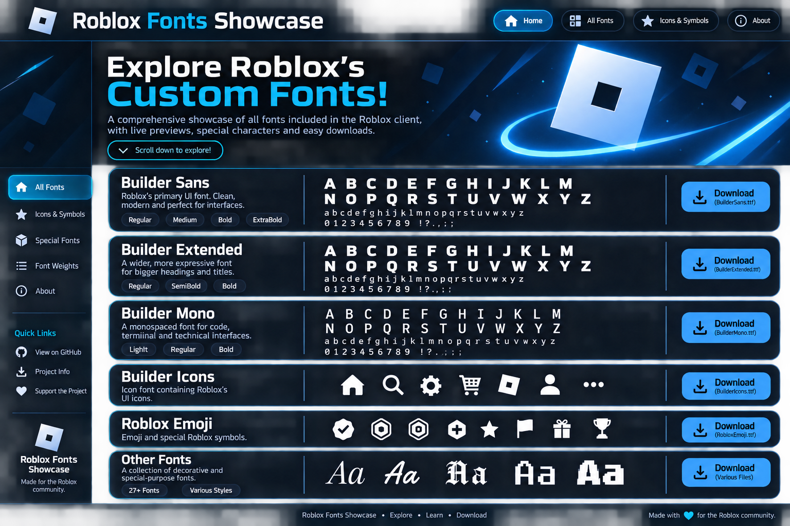

# Roblox Fonts Showcase

A static, GitHub Pages-ready browser for the font files supplied in the original `Custom Fonts.zip` archive.

## Features
- Separate sections for Builder Sans, Builder Extended, Builder Mono, Builder Icons, Roblox Emoji, language fonts, Roblox/brand font files and decorative fonts.
- Browser-rendered alphabet, lowercase, number and punctuation previews.
- Private-use Unicode glyph previews where a font's character map contains them.
- A direct download link for every individual original font file.
- Search, category filtering, sorting, and responsive mobile layout.
- No build step, server, framework, or external JavaScript dependency.

## Run locally
Open `index.html` in a modern browser. All fonts and data are loaded from the local `assets/` directory.

## Publish with GitHub Pages
1. Upload the contents of this folder to the root of a GitHub repository.
2. Open **Settings → Pages**.
3. Choose **Deploy from a branch**, select `main` and `/ (root)`, then save.
4. Wait for GitHub Pages to publish the site.

## Folder layout
- `index.html` — complete showcase application.
- `assets/source/` — original font files, preserving their source filenames and folder structure.
- `assets/data/fonts.json` — font metadata and Unicode character-map information used by the showcase.

## Important notes
- Files are copied from the provided archive without editing or converting them. Fonts inside the supplied ZIP font packs are extracted unchanged into `assets/source/extra-packs/`.
- A Unicode character-map entry does not prove that the glyph has visible artwork. Empty glyphs can render as blank; this is why the page labels the previews as actual browser-rendered glyphs rather than claiming every mapped character is visible.
- This is an unofficial community project and is not affiliated with or endorsed by Roblox Corporation.
- Font licences were not provided as a verified licence bundle. Before redistributing this repository publicly or using fonts commercially, check the licence/permissions for each font. The project code itself is provided under the MIT License; that does not relicense the font files.

## Credits
Font files are from the archive supplied by the repository owner. Keep any original attribution or licence notices that accompany individual fonts.
